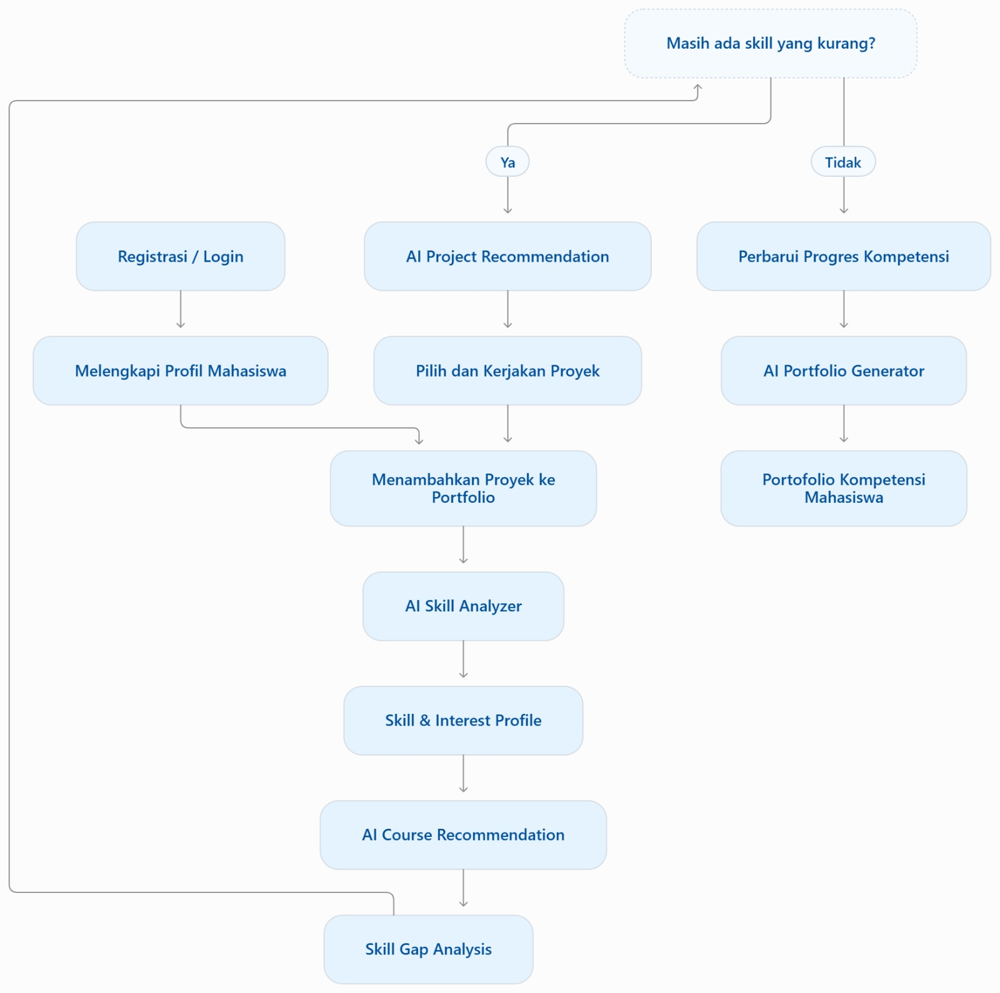

**SKILLPROOF**

**PRODUCT REQUIREMENTS DOCUMENT**

> ***AI-Powered Student Skill Mapping & Portfolio Platform***

---

> **Tujuan dokumen:** Menjadi acuan kebutuhan produk, prioritas fitur, perilaku AI, dan kriteria penerimaan untuk pengembangan MVP SkillProof.

| **Nama Produk** | SkillProof |
| --- | --- |
| **Jenis Dokumen** | Product Requirements Document (PRD) |
| **Versi** | 1.0 — Draft awal |
| **Status** | Untuk ditinjau dan disepakati tim |

## Informasi Dokumen

Dokumen ini menjabarkan kebutuhan produk SkillProof, yaitu platform yang membantu mahasiswa memetakan kompetensi berdasarkan proyek dan bukti pekerjaan yang pernah dilakukan. Dokumen ini merupakan draft awal yang dapat diperbarui berdasarkan hasil diskusi tim, validasi pengguna, dan batasan proyek kuliah.

| **Elemen** | **Keterangan** |
| --- | --- |
| Pemilik produk | Tim pengembang SkillProof |
| Pengguna utama | Mahasiswa yang ingin mengembangkan kompetensi dan mempersiapkan karier |
| Platform | Website responsif |
| Teknologi AI | LLM melalui API atau layanan model yang sesuai |
| Catatan | Target performa, indikator keberhasilan, dan detail implementasi perlu divalidasi tim |

## Daftar Isi

1. Product Overview

2. Problem Statement

3. Product Vision dan Goals

4. Target Users

5. Core Features

6. Functional Requirements

7. AI Requirements

8. User Flow

*Gambar 1. Alur penggunaan SkillProof berdasarkan rancangan tim.*

9. Non-Functional Requirements

10. Acceptance Criteria

11. Success Metrics

12. Scope MVP

13. Risiko, Ketergantungan, dan Asumsi

14. Pembeda Utama Produk

15. Pertanyaan Terbuka

## 1. Product Overview

SkillProof merupakan platform berbasis web yang membantu mahasiswa mengidentifikasi, memetakan, dan mengembangkan kompetensi berdasarkan proyek atau hasil pekerjaan yang pernah mereka kerjakan. Dengan bantuan kecerdasan buatan (AI), sistem menganalisis informasi dan bukti proyek untuk mengidentifikasi keterampilan yang relevan, menemukan kesenjangan kompetensi (skill gap), serta memberikan rekomendasi pembelajaran dan proyek yang sesuai.

SkillProof juga membantu mahasiswa membangun portofolio berbasis bukti yang dapat dibagikan kepada perekrut atau perusahaan untuk menunjukkan proyek, kontribusi, dan keterampilan yang telah mereka tunjukkan.

| **Atribut** | **Deskripsi** |
| --- | --- |
| Nama produk | SkillProof |
| Kategori | Education Technology (EdTech) dan Career Development |
| Platform | Website responsif |
| Target pengguna utama | Mahasiswa yang ingin mengembangkan kompetensi dan mempersiapkan diri memasuki dunia kerja |
| Peran AI | Menganalisis proyek, menyarankan skill yang relevan, membantu analisis skill gap, dan menghasilkan rekomendasi |

## 2. Problem Statement

Mahasiswa memperoleh pengetahuan dan pengalaman melalui perkuliahan, tugas, organisasi, dan proyek mandiri. Namun, pengalaman tersebut belum tentu diikuti pemahaman yang jelas mengenai kompetensi yang telah ditunjukkan dan keterampilan yang masih perlu dikembangkan.

- Kesulitan mengidentifikasi kompetensi yang dapat dibuktikan melalui proyek yang pernah dikerjakan.

- Tidak mengetahui skill gap antara bukti kompetensi yang dimiliki dan kompetensi yang dibutuhkan untuk tujuan karier.

- Pengembangan keterampilan kurang terarah karena mahasiswa belum mengetahui kursus atau proyek yang sesuai untuk dikerjakan selanjutnya.

- Portofolio belum selalu menjelaskan kontribusi individu, keterampilan yang digunakan, dan bukti yang mendukung keterampilan tersebut.

- Mahasiswa membutuhkan cara yang lebih terstruktur untuk menunjukkan kemampuan praktis saat melamar magang atau pekerjaan.

> **Pernyataan masalah utama:** Mahasiswa membutuhkan platform yang membantu mereka memahami kompetensi berdasarkan hasil pekerjaan nyata, mengidentifikasi kesenjangan keterampilan, dan menyusun langkah pengembangan diri serta portofolio secara terarah.

## 3. Product Vision dan Goals

### 3.1 Product Vision

Menjadi platform pengembangan kompetensi mahasiswa yang menghubungkan pengalaman mengerjakan proyek dengan pemetaan keterampilan, rekomendasi pengembangan diri, dan pembentukan portofolio berbasis bukti untuk mempersiapkan karier profesional.

### 3.2 Product Goals

- Membantu mahasiswa mengidentifikasi keterampilan berdasarkan proyek yang pernah dikerjakan.

- Menyajikan pemetaan kompetensi yang mudah dipahami dan terhubung dengan bukti proyek.

- Mengidentifikasi skill gap berdasarkan kompetensi target yang dipilih mahasiswa.

- Memberikan rekomendasi kursus dan proyek untuk meningkatkan keterampilan.

- Membantu mahasiswa menyusun portofolio yang menjelaskan proyek, kontribusi, dan kompetensi yang didukung bukti.

- Membantu mahasiswa merencanakan pengembangan kompetensi sesuai tujuan karier.

> **Batasan produk:** SkillProof memberikan analisis dan rekomendasi berdasarkan informasi serta bukti yang tersedia. Hasil AI bukan sertifikasi kompetensi dan tidak menjamin kesiapan kerja.

## 4. Target Users

| **Segmen pengguna** | **Kebutuhan** | **Solusi SkillProof** |
| --- | --- | --- |
| Mahasiswa tingkat awal | Mengetahui keterampilan yang mulai berkembang | Analisis proyek dan pemetaan skill |
| Mahasiswa tingkat akhir | Menemukan kekurangan kompetensi sebelum melamar kerja | Skill gap berdasarkan target karier |
| Mahasiswa aktif organisasi | Mengidentifikasi keterampilan dari kontribusi organisasi | Pemetaan skill berdasarkan peran dan bukti proyek |
| Mahasiswa pencari magang | Menyiapkan bukti kemampuan praktis | Portofolio berbasis proyek dan kompetensi |
| Mahasiswa yang ingin upskilling | Mengetahui langkah pengembangan berikutnya | Rekomendasi kursus dan proyek |

Fokus awal MVP disarankan pada mahasiswa yang sedang mempersiapkan diri untuk magang atau pekerjaan pertama. Fokus ini membantu tim memprioritaskan kebutuhan yang paling penting.

## 5. Core Features

### 5.1 Project Submission

Mahasiswa dapat menambahkan proyek yang pernah dikerjakan. Informasi proyek meliputi nama, deskripsi, tujuan, peran dan kontribusi individu, teknologi/tools yang digunakan, hasil proyek, serta bukti seperti tautan repositori, dokumen, gambar, atau demo.

### 5.2 AI Skill Analysis

AI menganalisis informasi proyek untuk menghasilkan kandidat skill yang relevan. Setiap skill sebaiknya disertai alasan dan bukti pendukung yang ditemukan. Sistem tidak boleh menyimpulkan penguasaan skill hanya karena nama teknologi disebutkan.

### 5.3 Skill Mapping Dashboard

Dashboard menampilkan daftar skill yang teridentifikasi, kategori keterampilan, proyek pendukung, ringkasan kompetensi, dan area yang ingin dikembangkan.

### 5.4 AI Skill Gap Analysis

Sistem membandingkan bukti skill yang tersedia dengan profil kompetensi target karier. Hasilnya membedakan skill yang telah memiliki bukti, yang bukti pendukungnya terbatas, dan yang belum memiliki bukti.

### 5.5 Personalized Learning & Project Recommendation

Sistem merekomendasikan kursus, materi, atau proyek latihan berdasarkan skill gap. Rekomendasi harus menjelaskan hubungan antara kebutuhan kompetensi dan aktivitas yang disarankan.

### 5.6 Portfolio Builder

Mahasiswa memilih proyek yang ingin ditampilkan. Portofolio berisi profil, proyek, kontribusi individu, skill yang telah ditinjau, serta tautan demo atau repositori. Pengguna mengatur informasi yang dapat dilihat publik.

## 6. Functional Requirements

| **ID** | **Fitur** | **Kebutuhan fungsional** | **Prioritas** |
| --- | --- | --- | --- |
| FR-01 | Registrasi / Login | Sistem memungkinkan mahasiswa membuat akun dan masuk ke akun. | Must Have |
| FR-02 | Profil Mahasiswa | Mahasiswa dapat melengkapi dan memperbarui profil serta minat pengembangan. | Must Have |
| FR-03 | Project Submission | Mahasiswa dapat menambah, melihat, mengubah, dan menghapus proyek miliknya. | Must Have |
| FR-04 | AI Skill Analyzer | Sistem menganalisis proyek dan menghasilkan kandidat skill beserta alasan atau bukti pendukung. | Must Have |
| FR-05 | Skill & Interest Profile | Sistem menampilkan ringkasan skill, bukti proyek, dan minat mahasiswa. | Must Have |
| FR-06 | AI Course Recommendation | Sistem merekomendasikan kursus atau materi yang relevan dengan kebutuhan pengembangan. | Must Have |
| FR-07 | Skill Gap Analysis | Sistem membandingkan bukti skill dengan kompetensi target dan menampilkan area yang perlu dikembangkan. | Must Have |
| FR-08 | AI Project Recommendation | Jika ada skill yang perlu dikembangkan, sistem merekomendasikan proyek latihan yang relevan. | Must Have |
| FR-09 | Progress Kompetensi | Mahasiswa dapat memperbarui progres berdasarkan proyek atau bukti baru. | Must Have |
| FR-10 | AI Portfolio Generator | Sistem menghasilkan draf portofolio kompetensi dari proyek dan skill yang telah ditinjau. | Must Have |
| FR-11 | Pengaturan Portofolio Publik | Mahasiswa dapat memilih informasi yang akan ditampilkan melalui tautan publik. | Should Have |

Prioritas di atas merupakan usulan untuk MVP. Tim dapat mengubah prioritas berdasarkan waktu pengerjaan, kapasitas tim, dan hasil validasi pengguna.

## 7. AI Requirements

| **ID** | **Kebutuhan AI** | **Deskripsi** |
| --- | --- | --- |
| AI-01 | Project Understanding | Memahami deskripsi proyek, peran mahasiswa, dan bukti yang diberikan. |
| AI-02 | Skill Extraction | Mengidentifikasi kandidat keterampilan yang relevan dengan proyek. |
| AI-03 | Evidence Mapping | Menghubungkan skill dengan bukti proyek yang mendukungnya. |
| AI-04 | Skill Gap Identification | Membantu mengidentifikasi kompetensi target yang belum memiliki bukti memadai. |
| AI-05 | Recommendation Generation | Menghasilkan rekomendasi pembelajaran dan proyek berdasarkan kebutuhan kompetensi. |
| AI-06 | Explainable Results | Menjelaskan alasan di balik hasil analisis dan rekomendasi. |
| AI-07 | Uncertainty Handling | Menyatakan ketika informasi atau bukti tidak cukup untuk menghasilkan kesimpulan yang meyakinkan. |

Pendekatan implementasi yang disarankan adalah menggunakan LLM melalui API untuk menganalisis informasi proyek dan menghasilkan kandidat skill serta rekomendasi. Aplikasi tetap bertanggung jawab menyimpan data, menghubungkan skill dengan bukti, mengatur hak akses, dan menyajikan hasil kepada pengguna.

> **Prinsip AI:** Hasil analisis harus dapat ditinjau dan dikoreksi pengguna. Ketiadaan bukti tidak berarti pengguna pasti tidak memiliki skill; hal itu hanya berarti sistem belum menemukan bukti yang cukup.

## 8. User Flow

Registrasi / Login → Melengkapi Profil Mahasiswa → Menambahkan Proyek ke Portofolio → AI Skill Analyzer → Skill & Interest Profile → AI Course Recommendation → Skill Gap Analysis → Keputusan: Masih ada skill yang kurang?

Jika masih ada skill yang kurang, sistem menampilkan AI Project Recommendation. Mahasiswa memilih dan mengerjakan proyek yang disarankan, kemudian menambahkan hasilnya ke portofolio untuk dianalisis kembali. Jika tidak ada skill yang kurang, mahasiswa dapat memperbarui progres kompetensi dan menggunakan AI Portfolio Generator untuk menghasilkan Portofolio Kompetensi Mahasiswa. Pengguna harus dapat meninjau dan mengoreksi hasil identifikasi skill sebelum hasil tersebut ditampilkan pada portofolio publik.

## 9. Non-Functional Requirements

| **ID** | **Kategori** | **Kebutuhan** |
| --- | --- | --- |
| NFR-01 | Security | Data proyek dan profil hanya dapat diakses sesuai hak akses pengguna. |
| NFR-02 | Privacy | Pengguna dapat menentukan informasi dan proyek yang ditampilkan secara publik. |
| NFR-03 | Performance | Waktu respons ditetapkan dan diuji pada skenario penggunaan yang disepakati tim. |
| NFR-04 | Usability | Antarmuka mudah digunakan dan responsif pada desktop maupun perangkat mobile. |
| NFR-05 | Reliability | Sistem menangani kegagalan layanan AI dan memberi informasi yang jelas kepada pengguna. |
| NFR-06 | AI Transparency | Hasil analisis AI disertai alasan dan bukti yang relevan jika tersedia. |
| NFR-07 | Data Integrity | Perubahan data proyek diperbarui secara konsisten pada pemetaan skill dan portofolio. |

## 10. Acceptance Criteria

### 10.1 FR-04 — Project Submission

- Mahasiswa dapat menambahkan proyek dengan mengisi informasi yang diwajibkan.

- Sistem memvalidasi kolom wajib sebelum menyimpan proyek.

- Mahasiswa dapat mengubah atau menghapus proyek miliknya.

- Proyek yang telah disimpan dapat dibuka kembali untuk ditinjau.

### 10.2 FR-05 — AI Skill Analysis

- Sistem menerima informasi proyek yang valid.

- Sistem menghasilkan kandidat skill yang relevan.

- Setiap skill disertai penjelasan atau bukti pendukung jika tersedia.

- Sistem tidak menyatakan skill sebagai kompetensi yang terbukti apabila informasi pendukung tidak memadai.

- Pengguna dapat meninjau dan mengoreksi hasil analisis.

### 10.3 FR-08 — Skill Gap Analysis

- Mahasiswa dapat menentukan kompetensi target.

- Sistem membandingkan kompetensi target dengan bukti skill yang tersedia.

- Sistem membedakan skill yang telah memiliki bukti, yang buktinya terbatas, dan yang belum memiliki bukti.

- Sistem menjelaskan kesenjangan yang ditemukan.

### 10.4 FR-10 — Portfolio Builder

- Mahasiswa dapat memilih proyek yang akan ditampilkan.

- Portofolio menampilkan deskripsi dan kontribusi mahasiswa.

- Portofolio menampilkan skill yang telah ditinjau oleh mahasiswa.

- Mahasiswa dapat mengatur informasi yang boleh dilihat publik.

## 11. Success Metrics

| **Indikator** | **Metode pengukuran** |
| --- | --- |
| Relevansi AI Skill Analyzer | Persentase skill hasil analisis yang dinilai relevan oleh evaluator. |
| Kualitas skill gap | Kesesuaian antara bukti proyek, kompetensi target, dan hasil gap yang ditampilkan. |
| Relevansi rekomendasi kursus | Penilaian pengguna terhadap relevansi kursus atau materi yang disarankan. |
| Relevansi rekomendasi proyek | Penilaian pengguna/evaluator apakah proyek yang disarankan melatih skill gap terkait. |
| Keberhasilan AI Portfolio Generator | Persentase pengguna uji yang berhasil menghasilkan dan meninjau portofolio. |
| Usability | Keberhasilan pengguna menyelesaikan alur utama dalam pengujian. |
| Manfaat pengembangan diri | Perubahan pemahaman mahasiswa tentang kompetensi dan kebutuhan pengembangan setelah memakai platform. |

Target numerik ditentukan setelah tim menyepakati skenario pengujian dan melaksanakan uji coba awal. Target tidak sebaiknya ditetapkan tanpa mempertimbangkan jumlah peserta dan kondisi pengujian.

## 12. Scope MVP

### 12.1 Fitur MVP

- Registrasi dan login.

- Profil mahasiswa.

- Penambahan dan pengelolaan proyek.

- Analisis proyek menggunakan AI.

- Pemetaan skill berdasarkan bukti proyek.

- Pemilihan target karier.

- Analisis skill gap.

- Rekomendasi kursus dan proyek.

- Pembuatan portofolio.

### 12.2 Fitur di Luar MVP / Pengembangan Lanjutan

- Integrasi dengan LinkedIn.

- Integrasi otomatis dengan GitHub.

- Analisis file proyek secara lebih mendalam.

- Verifikasi kompetensi oleh dosen atau mentor.

- Rekomendasi lowongan magang berdasarkan kompetensi.

- Pelacakan perkembangan skill dalam jangka panjang.

## 13. Risiko, Ketergantungan, dan Asumsi

| **Jenis** | **Uraian** | **Mitigasi awal** |
| --- | --- | --- |
| Risiko AI | AI dapat salah mengidentifikasi skill atau menghasilkan rekomendasi yang kurang relevan. | Tampilkan alasan dan bukti; izinkan pengguna meninjau serta mengoreksi hasil. |
| Privasi | Proyek dapat memuat data pribadi atau informasi milik pihak lain. | Berikan pengaturan visibilitas, peringatan data sensitif, dan kontrol akses. |
| Ketergantungan API | Layanan AI eksternal dapat mengalami gangguan atau membatasi penggunaan. | Tangani error dengan baik dan siapkan batas penggunaan serta pesan kegagalan. |
| Kualitas data | Deskripsi proyek yang minim dapat menghasilkan analisis yang tidak akurat. | Minta kolom penting dan tampilkan peringatan jika bukti tidak cukup. |
| Asumsi kompetensi | Profil kompetensi target mungkin belum mewakili semua kebutuhan industri. | Gunakan referensi yang relevan dan dokumentasikan sumber kompetensi. |

## 14. Pembeda Utama Produk

SkillProof tidak hanya mengubah deskripsi proyek menjadi daftar keterampilan. Nilai utama produk terletak pada hubungan antara proyek nyata, bukti kompetensi, analisis skill gap, rekomendasi pengembangan, dan portofolio.

> **Alur nilai utama:** Project → Evidence → Skill Mapping → Skill Gap → Learning Recommendation → Portfolio

Contohnya, mahasiswa yang membuat aplikasi menggunakan React tidak langsung dianggap menguasai React hanya karena teknologi tersebut tercantum pada deskripsi. Sistem perlu mempertimbangkan peran mahasiswa dan bukti yang tersedia. Hasilnya digunakan untuk membandingkan kompetensi yang telah ditunjukkan dengan kompetensi target, kemudian menyarankan langkah pengembangan yang relevan.

## 15. Pertanyaan Terbuka

Beberapa keputusan berikut perlu dikonfirmasi oleh tim sebelum implementasi teknis dimulai:

- Sumber kompetensi target: apakah menggunakan daftar kompetensi yang disusun tim berdasarkan referensi pekerjaan, atau kerangka kompetensi tertentu?

- Input proyek pada MVP: apakah cukup berupa deskripsi dan tautan bukti, atau perlu mendukung unggahan PDF, dokumentasi, dan gambar?

- Format portofolio: apakah cukup berupa halaman publik yang dapat dibagikan, atau perlu tersedia fitur ekspor PDF?

- Sumber rekomendasi: apakah kursus dan proyek berasal dari katalog yang dikelola tim, sumber eksternal, atau kombinasi keduanya?

- Batasan teknis: framework, database, layanan AI, anggaran API, dan waktu pengembangan yang tersedia.

## Penutup

Dokumen ini menjadi dasar awal untuk menyepakati ruang lingkup dan kebutuhan SkillProof. Sebelum implementasi, tim disarankan memvalidasi masalah melalui calon pengguna, menyepakati sumber kompetensi target, menentukan teknologi, dan menyusun rancangan UI/UX serta model data berdasarkan kebutuhan yang telah disetujui.

### 5.1 Project Submission — Menambahkan Proyek ke Portofolio

Mahasiswa menambahkan proyek yang pernah dikerjakan dengan mengisi nama, deskripsi, tujuan, peran dan kontribusi individu, teknologi/tools yang digunakan, hasil proyek, serta bukti pendukung seperti tautan repositori, dokumen, gambar, atau demo.

### 5.2 AI Skill Analyzer

Sistem menganalisis informasi dan bukti proyek untuk mengidentifikasi kandidat keterampilan yang relevan. Hasil analisis perlu menjelaskan alasan dan bukti pendukung. Mahasiswa dapat meninjau atau mengoreksi hasil sebelum disimpan ke profil skill.

### 5.3 Skill & Interest Profile

Sistem menyusun profil yang merangkum skill yang telah teridentifikasi, bukti proyek yang mendukung, serta minat pengembangan yang dinyatakan mahasiswa. Profil ini menjadi dasar untuk rekomendasi kursus dan analisis skill gap.

### 5.4 AI Course Recommendation

Sistem memberikan rekomendasi kursus atau materi pembelajaran berdasarkan skill yang ingin dikembangkan, minat mahasiswa, dan hasil analisis proyek. Setiap rekomendasi sebaiknya menyertakan alasan relevansi dan skill yang dituju.

### 5.5 Skill Gap Analysis

Sistem membandingkan skill yang didukung bukti dengan kompetensi target yang dipilih mahasiswa. Hasilnya membedakan skill yang telah memiliki bukti, skill yang buktinya masih terbatas, dan skill yang belum memiliki bukti. Sistem kemudian menanyakan apakah masih ada skill yang perlu dikembangkan.

### 5.6 AI Project Recommendation

Jika masih ada skill yang kurang atau belum memiliki bukti memadai, sistem merekomendasikan proyek latihan yang relevan. Mahasiswa memilih dan mengerjakan proyek tersebut, lalu menambahkannya ke portofolio agar siklus analisis dapat diulang.

### 5.7 Progress Kompetensi

Jika mahasiswa menilai tidak ada skill prioritas yang masih kurang, mahasiswa dapat memperbarui progres kompetensi berdasarkan proyek atau bukti baru. Progres harus merefleksikan bukti yang tersedia, bukan hanya klaim tanpa dukungan.

### 5.8 AI Portfolio Generator

Sistem menyusun portofolio kompetensi berdasarkan profil mahasiswa, proyek yang dipilih, skill yang telah ditinjau, dan bukti pendukungnya. Mahasiswa dapat memeriksa hasil akhir dan menentukan informasi yang akan ditampilkan secara publik.

### 10.1 FR-03 — Project Submission

- Mahasiswa dapat menambahkan proyek dengan mengisi informasi wajib.

- Sistem memvalidasi kolom wajib sebelum menyimpan proyek.

- Mahasiswa dapat mengubah atau menghapus proyek miliknya.

### 10.2 FR-04 — AI Skill Analyzer

- Sistem menghasilkan kandidat skill berdasarkan informasi proyek yang tersedia.

- Hasil analisis menyertakan alasan atau bukti pendukung jika tersedia.

- Mahasiswa dapat meninjau dan mengoreksi hasil analisis sebelum disimpan.

### 10.3 FR-06 — AI Course Recommendation

- Sistem menampilkan rekomendasi kursus atau materi yang berhubungan dengan skill yang ingin dikembangkan.

- Setiap rekomendasi menyertakan alasan relevansi dan skill yang dituju.

### 10.4 FR-07 — Skill Gap Analysis

- Sistem membandingkan skill yang memiliki bukti dengan kompetensi target.

- Sistem membedakan skill dengan bukti memadai, bukti terbatas, dan belum ada bukti.

- Sistem menampilkan keputusan apakah ada skill prioritas yang perlu dikembangkan.

### 10.5 FR-08 — AI Project Recommendation

- Jika ada skill yang perlu dikembangkan, sistem menyajikan rekomendasi proyek yang sesuai.

- Rekomendasi menjelaskan skill yang dilatih dan hasil yang diharapkan.

- Mahasiswa dapat memilih proyek dan menambahkan hasil pengerjaan ke portofolio.

### 10.6 FR-10 — AI Portfolio Generator

- Sistem menyusun draf portofolio dari proyek dan skill yang telah ditinjau.

- Portofolio menampilkan kontribusi mahasiswa dan bukti proyek yang tersedia.

- Mahasiswa dapat memeriksa isi dan mengatur informasi yang ditampilkan secara publik.