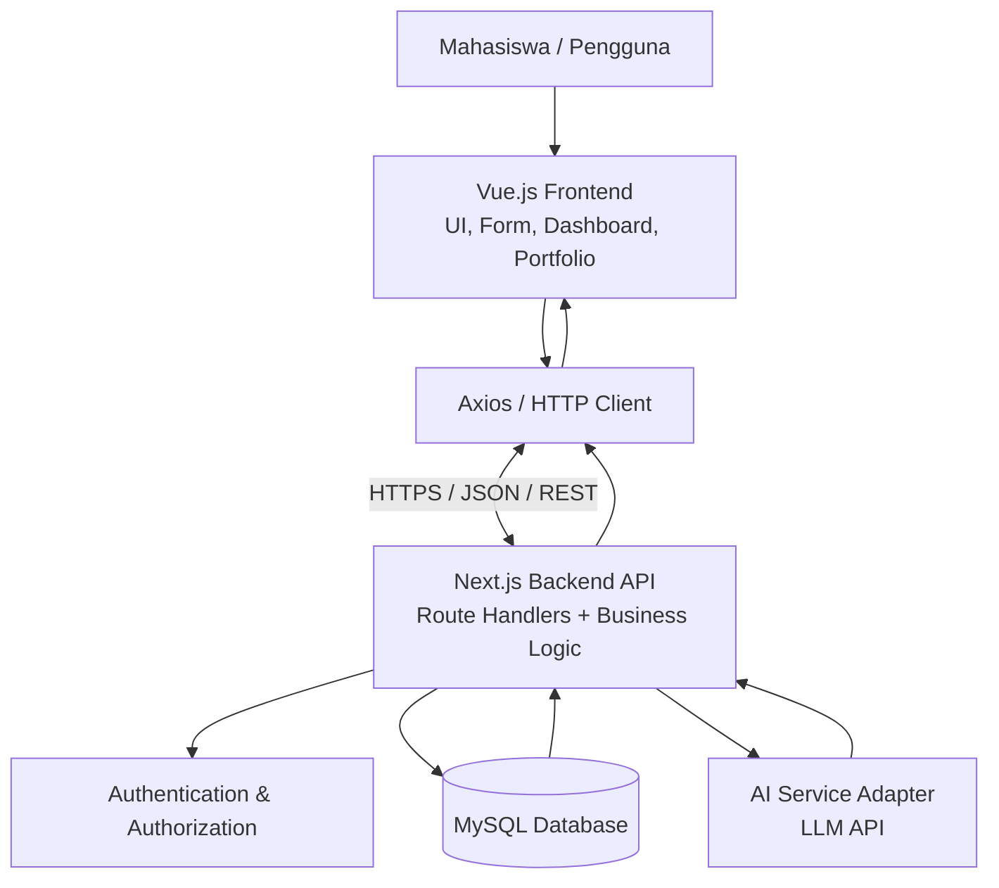
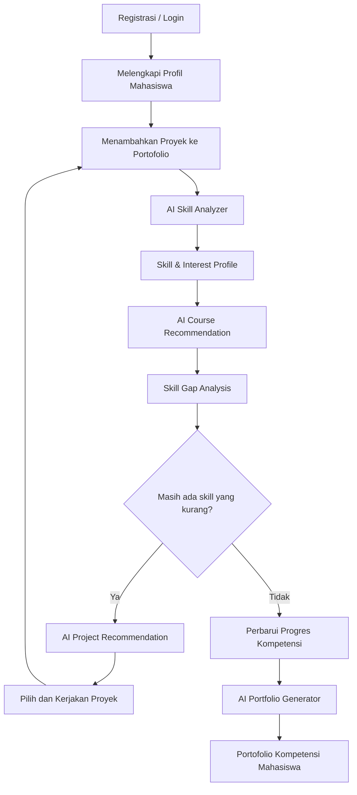

# SkillProof — System Architecture

> **Dokumen:** `architecture.md`  
> **Versi:** 1.0  
> **Status:** Draft untuk proyek kuliah  
> **Tujuan:** Menjelaskan arsitektur sistem, komponen teknologi, alur komunikasi, rancangan API, dan pertimbangan keamanan untuk pengembangan SkillProof.

---

## 1. Ringkasan Sistem

SkillProof adalah platform berbasis web yang membantu mahasiswa memetakan kompetensi berdasarkan proyek dan bukti pekerjaan yang pernah dilakukan. Sistem menggunakan AI untuk membantu menganalisis proyek, mengidentifikasi kandidat keterampilan, menemukan *skill gap*, merekomendasikan kursus dan proyek latihan, serta menghasilkan portofolio kompetensi.

Arsitektur yang digunakan memisahkan frontend dan backend:

- **Frontend:** Vue.js
- **Backend API:** Next.js Route Handlers
- **API style:** REST API
- **Format pertukaran data:** JSON
- **HTTP client frontend:** Axios
- **Database:** MySQL
- **Database driver:** `mysql2`
- **AI integration:** LLM API melalui backend Next.js

> **Catatan arsitektur:** Next.js biasanya digunakan sebagai framework full-stack berbasis React. Dalam proyek ini, Next.js digunakan khusus sebagai backend API, sedangkan Vue.js menangani antarmuka pengguna. Keduanya dijalankan sebagai aplikasi terpisah.

## 2. Tujuan Arsitektur

Arsitektur ini dirancang untuk:

1. Memisahkan antarmuka pengguna dari logika bisnis dan penyimpanan data.
2. Memungkinkan frontend dan backend dikembangkan serta diuji secara independen.
3. Menyediakan API yang konsisten untuk fitur SkillProof.
4. Menjaga kredensial database dan kunci API AI tetap berada di server.
5. Memudahkan pengembangan fitur baru tanpa mengubah seluruh sistem.

## 3. Diagram Arsitektur



### Penjelasan komponen

| Komponen | Tanggung jawab |
|---|---|
| Vue.js Frontend | Menampilkan halaman, form proyek, dashboard skill, rekomendasi, dan portofolio. |
| Axios | Mengirim HTTP request dari frontend dan menangani respons API. |
| Next.js API | Memvalidasi request, menjalankan logika bisnis, mengatur akses, berkomunikasi dengan database dan layanan AI. |
| Authentication & Authorization | Memverifikasi identitas pengguna dan memastikan data hanya dapat diakses oleh pemilik atau pihak yang diizinkan. |
| AI Service Adapter | Membungkus pemanggilan LLM API, menyusun prompt, memvalidasi keluaran, dan menangani kegagalan layanan AI. |
| MySQL | Menyimpan data akun, profil, proyek, hasil analisis, skill, rekomendasi, dan konfigurasi portofolio. |
| LLM API | Membantu analisis proyek dan menghasilkan kandidat skill serta rekomendasi berdasarkan data yang dikirimkan. |

## 4. Tumpukan Teknologi

| Lapisan | Teknologi | Penggunaan |
|---|---|---|
| Frontend | Vue.js 3 | UI dan interaksi pengguna |
| Frontend tooling | Vite | Menjalankan development server dan membangun frontend |
| HTTP client | Axios | Memanggil REST API |
| Backend | Next.js Route Handlers | Endpoint API dan logika server |
| Runtime | Node.js | Menjalankan backend |
| API style | REST | Pola komunikasi frontend–backend |
| Data format | JSON | Format request dan response |
| Database | MySQL | Penyimpanan data relasional |
| MySQL driver | `mysql2` | Koneksi backend ke MySQL |
| AI | LLM API | Analisis proyek, skill gap, dan rekomendasi |
| API testing | Postman | Pengujian endpoint |
| Version control | Git | Kolaborasi dan pengelolaan kode |

Versi library dan penyedia LLM belum dikunci. Tim perlu memilih versi stabil dan menyepakatinya sebelum implementasi.

## 5. Batas Tanggung Jawab

### 5.1 Frontend — Vue.js

Frontend bertanggung jawab untuk:

- Registrasi, login, dan pengelolaan profil melalui API.
- Form tambah, ubah, lihat, dan hapus proyek.
- Menampilkan hasil AI Skill Analyzer.
- Menampilkan Skill & Interest Profile.
- Menampilkan rekomendasi kursus dan proyek.
- Menampilkan hasil Skill Gap Analysis.
- Mengizinkan pengguna meninjau hasil analisis sebelum menyimpannya.
- Menampilkan dan mengatur portofolio.
- Menampilkan status proses, pesan validasi, dan error dari API.

Frontend **tidak boleh** menyimpan kredensial database atau kunci rahasia LLM API.

### 5.2 Backend — Next.js

Backend bertanggung jawab untuk:

- Menyediakan endpoint REST API.
- Memvalidasi input dan memeriksa hak akses.
- Menjalankan aturan bisnis SkillProof.
- Mengelola sesi atau token autentikasi.
- Mengakses MySQL menggunakan `mysql2`.
- Memanggil layanan LLM melalui server-side adapter.
- Memvalidasi struktur keluaran AI sebelum disimpan atau dikirim ke frontend.
- Mengelola error, logging, dan pembatasan request yang sesuai.
- Menjaga agar pengguna hanya dapat mengubah data miliknya.

### 5.3 Database — MySQL

Database bertanggung jawab untuk menyimpan data terstruktur. Skema final perlu disepakati saat desain database. Entitas awal yang diperkirakan dibutuhkan:

- `users`
- `student_profiles`
- `projects`
- `project_evidence`
- `skills`
- `project_skills`
- `career_targets`
- `course_recommendations`
- `project_recommendations`
- `skill_gap_results`
- `portfolios`

Nama tabel tersebut merupakan rancangan awal, bukan skema final. Struktur relasi, tipe data, indeks, dan aturan penghapusan perlu ditetapkan pada dokumen database design.

## 6. Diagram Konteks dan Alur Data

### 6.1 Alur umum request

1. Pengguna melakukan aksi di Vue.js.
2. Vue.js mengirim HTTP request melalui Axios ke endpoint Next.js.
3. Backend memvalidasi request, autentikasi, otorisasi, dan data masukan.
4. Jika diperlukan, backend membaca atau menulis data ke MySQL.
5. Jika diperlukan, backend memanggil layanan AI.
6. Backend memvalidasi hasil dan mengembalikan respons JSON dengan status HTTP yang sesuai.
7. Vue.js memperbarui tampilan berdasarkan respons.

### 6.2 Alur AI Skill Analyzer

1. Mahasiswa mengirim data proyek dan bukti pendukung.
2. Backend memeriksa kepemilikan proyek dan kelengkapan input.
3. Backend mengirim konteks proyek yang relevan ke LLM API.
4. LLM menghasilkan kandidat skill, alasan, dan bukti yang berkaitan jika tersedia.
5. Backend memvalidasi format keluaran dan menandai hasil yang tidak pasti.
6. Hasil ditampilkan kepada mahasiswa untuk ditinjau atau dikoreksi.
7. Hasil yang disetujui disimpan ke database dan digunakan untuk memperbarui Skill & Interest Profile.

### 6.3 Alur Skill Gap Analysis

1. Mahasiswa memilih target karier atau kompetensi target.
2. Backend mengambil skill yang sudah memiliki bukti dan kompetensi target.
3. Sistem membandingkan keduanya berdasarkan aturan yang ditentukan tim.
4. Sistem mengelompokkan kompetensi menjadi:
   - **Didukung bukti:** terdapat bukti proyek yang relevan.
   - **Bukti terbatas:** ada indikasi, tetapi bukti belum cukup.
   - **Belum ada bukti:** sistem belum menemukan bukti yang relevan.
5. Hasil ditampilkan kepada mahasiswa.
6. Jika masih ada skill prioritas yang perlu dikembangkan, sistem merekomendasikan proyek latihan.
7. Jika tidak ada skill prioritas yang perlu dikembangkan, mahasiswa dapat memperbarui progres dan membuat portofolio kompetensi.

> “Belum ada bukti” tidak sama dengan “mahasiswa tidak memiliki keterampilan”. Sistem harus menghindari klaim yang lebih kuat daripada bukti yang tersedia.

## 7. Alur Produk Utama



Rekomendasi kursus dapat tetap tersedia bagi pengguna meskipun skill gap prioritas sudah kecil. Keputusan “Tidak” pada diagram menunjukkan bahwa pengguna dapat melanjutkan ke pembaruan progres dan pembuatan portofolio, bukan bahwa pembelajaran selanjutnya dilarang.

## 8. Rancangan REST API

Semua endpoint API menggunakan prefix `/api`. Respons menggunakan JSON. Endpoint yang membutuhkan identitas pengguna harus dilindungi autentikasi dan otorisasi.

| Method | Endpoint | Tujuan |
|---|---|---|
| `POST` | `/api/auth/register` | Membuat akun mahasiswa |
| `POST` | `/api/auth/login` | Login |
| `POST` | `/api/auth/logout` | Logout |
| `GET` | `/api/profile` | Mengambil profil pengguna aktif |
| `PUT` | `/api/profile` | Memperbarui profil pengguna aktif |
| `GET` | `/api/projects` | Mengambil proyek milik pengguna |
| `POST` | `/api/projects` | Menambahkan proyek |
| `GET` | `/api/projects/:id` | Melihat detail proyek |
| `PUT` | `/api/projects/:id` | Memperbarui proyek |
| `DELETE` | `/api/projects/:id` | Menghapus proyek |
| `POST` | `/api/projects/:id/analyze` | Menjalankan AI Skill Analyzer |
| `GET` | `/api/skills/profile` | Mengambil Skill & Interest Profile |
| `POST` | `/api/recommendations/courses` | Mendapatkan rekomendasi kursus |
| `POST` | `/api/skill-gaps/analyze` | Menjalankan Skill Gap Analysis |
| `POST` | `/api/recommendations/projects` | Mendapatkan rekomendasi proyek latihan |
| `PUT` | `/api/competency-progress` | Memperbarui progres kompetensi |
| `POST` | `/api/portfolio/generate` | Membuat draf portofolio |
| `GET` | `/api/portfolio/me` | Mengambil portofolio milik pengguna |
| `PUT` | `/api/portfolio/me` | Memperbarui konten dan pengaturan portofolio |
| `GET` | `/api/portfolio/public/:slug` | Mengambil portofolio yang memang dipublikasikan |

Daftar endpoint di atas adalah kontrak awal. Metode, nama endpoint, validasi, dan skema respons harus disepakati tim sebelum implementasi.

### 8.1 Contoh format respons sukses

```json
{
  "success": true,
  "data": {
    "id": 12,
    "name": "SkillProof Project",
    "skills": ["Vue.js", "REST API", "MySQL"]
  },
  "message": "Data berhasil diambil"
}
```

### 8.2 Contoh format respons error

```json
{
  "success": false,
  "error": {
    "code": "VALIDATION_ERROR",
    "message": "Nama proyek wajib diisi"
  }
}
```

Gunakan status HTTP yang sesuai, misalnya `200` untuk sukses membaca data, `201` untuk data yang berhasil dibuat, `400` untuk input tidak valid, `401` untuk belum terautentikasi, `403` untuk tidak memiliki izin, `404` untuk data tidak ditemukan, `429` untuk pembatasan request, dan `500` untuk kesalahan server.

## 9. Integrasi Frontend dan Backend

### 9.1 Penggunaan Axios

Frontend dapat menggunakan Axios untuk memanggil endpoint backend. Simpan base URL di konfigurasi environment frontend, misalnya:

```env
VITE_API_BASE_URL=http://localhost:3000/api
```

Contoh instance Axios:

```javascript
// src/lib/api.js
import axios from "axios";

export const api = axios.create({
  baseURL: import.meta.env.VITE_API_BASE_URL,
  headers: {
    "Content-Type": "application/json"
  },
  timeout: 15000
});
```

Contoh pemanggilan endpoint:

```javascript
import { api } from "@/lib/api";

export async function getProjects() {
  const response = await api.get("/projects");
  return response.data;
}
```

Contoh tersebut mengasumsikan Vue.js dibangun menggunakan Vite dan backend berjalan pada port `3000`.

### 9.2 CORS

Dalam pengembangan lokal, frontend dan backend biasanya berjalan pada origin berbeda. Backend perlu mengizinkan origin frontend yang benar melalui konfigurasi CORS.

- Izinkan hanya origin frontend yang dikenal, misalnya `http://localhost:5173` saat development.
- Jangan menggunakan wildcard `*` untuk API yang memakai kredensial.
- Jika menggunakan cookie lintas origin, atur `credentials`, `SameSite`, `Secure`, dan CORS secara konsisten.
- Pada produksi, gunakan domain HTTPS yang telah ditentukan.

## 10. Integrasi MySQL

Backend Next.js dapat menggunakan `mysql2` untuk terhubung ke MySQL.

Instalasi paket:

```bash
npm install mysql2
```

Contoh variabel environment backend:

```env
DB_HOST=localhost
DB_PORT=3306
DB_USER=skillproof_app
DB_PASSWORD=replace_with_a_strong_password
DB_NAME=skillproof
```

Jangan menyimpan file `.env` ke repository. Tambahkan `.env*` yang berisi rahasia ke `.gitignore`, lalu sediakan `.env.example` tanpa nilai rahasia.

Prinsip akses database:

- Koneksi database hanya dilakukan di backend.
- Gunakan query berparameter atau prepared statements.
- Gunakan akun database dengan hak minimum yang diperlukan.
- Jangan mengirim password database ke frontend.
- Gunakan connection pooling sesuai kebutuhan deployment.
- Gunakan migration atau skrip skema yang terkontrol agar struktur database konsisten.

## 11. Integrasi AI

LLM API dipanggil dari backend, bukan langsung dari Vue.js. Dengan demikian, kunci API tidak terekspos kepada pengguna.

Tanggung jawab adapter AI:

1. Menyiapkan konteks proyek yang diperlukan dan relevan.
2. Mengirim prompt dengan format keluaran yang diharapkan.
3. Memvalidasi struktur dan tipe data hasil AI.
4. Menangani timeout, kegagalan provider, dan respons yang tidak valid.
5. Menyimpan hasil analisis yang diperlukan setelah ditinjau pengguna.
6. Menghindari pengiriman data pribadi atau rahasia proyek yang tidak diperlukan.
7. Menerapkan batas penggunaan agar biaya dan penyalahgunaan dapat dikendalikan.

Hasil AI diperlakukan sebagai **rekomendasi**, bukan fakta yang selalu benar. Pengguna perlu dapat meninjau atau mengoreksi skill yang diidentifikasi sebelum hasil ditampilkan sebagai klaim kompetensi publik.

## 12. Keamanan dan Privasi

Persyaratan keamanan minimum:

- Hash password menggunakan algoritma yang sesuai, bukan menyimpan password dalam teks biasa.
- Validasi input di backend; jangan hanya mengandalkan validasi frontend.
- Terapkan autentikasi dan otorisasi pada setiap endpoint privat.
- Pastikan pengguna hanya dapat mengubah proyek dan portofolio miliknya.
- Lindungi endpoint dari akses tanpa izin, brute force, dan request berlebihan.
- Simpan rahasia pada environment variables atau secret manager.
- Gunakan HTTPS di lingkungan produksi.
- Batasi ukuran dan jenis file jika unggah file didukung.
- Jangan menampilkan proyek sebagai publik secara default tanpa persetujuan pengguna.
- Catat error tanpa membocorkan password, token, kunci API, atau data sensitif.
- Tetapkan kebijakan retensi dan penghapusan data yang sesuai.

## 13. Penanganan Error dan Observabilitas

Backend perlu mengembalikan error yang konsisten dan tidak mengekspos detail internal. Frontend harus menampilkan pesan yang bisa dipahami pengguna.

Kasus yang perlu ditangani:

- Input tidak lengkap atau tidak valid.
- Pengguna belum login atau tidak memiliki izin.
- Proyek tidak ditemukan.
- Database tidak tersedia.
- LLM API timeout, limit terlampaui, atau menghasilkan format tidak valid.
- Portofolio belum siap atau tidak dipublikasikan.
- Request terlalu sering.

Gunakan logging server-side secukupnya untuk membantu debugging. Jangan mencatat rahasia atau seluruh isi proyek jika tidak diperlukan.

## 14. Deployment

Deployment dapat menggunakan tiga komponen yang dikelola secara terpisah:

1. **Vue.js frontend:** di-host sebagai aplikasi web statis atau layanan frontend.
2. **Next.js backend:** di-host pada lingkungan yang mendukung Node.js/Next.js Route Handlers.
3. **MySQL:** di-host pada server database atau layanan database terkelola.

Konfigurasi produksi harus menetapkan domain frontend, domain API, CORS, environment variables, koneksi database, dan kunci layanan AI. Pastikan database tidak diekspos langsung ke browser atau internet publik.

## 15. Struktur Repository yang Disarankan

```text
skillproof/
├── frontend/                 # Vue.js + Vite
│   ├── src/
│   │   ├── components/
│   │   ├── views/
│   │   ├── router/
│   │   ├── services/         # Fungsi pemanggil API
│   │   └── lib/
│   ├── .env.example
│   └── package.json
├── backend/                  # Next.js API
│   ├── app/
│   │   └── api/
│   ├── lib/
│   │   ├── db/
│   │   ├── auth/
│   │   └── ai/
│   ├── .env.example
│   └── package.json
├── database/
│   ├── migrations/
│   └── seed/
├── docs/
│   └── architecture.md
└── README.md
```

Struktur ini merupakan contoh. Tim dapat menyesuaikan nama direktori dengan konvensi proyek, tetapi frontend dan backend sebaiknya tetap memiliki konfigurasi serta dependency masing-masing.

## 16. Keputusan Arsitektur

| Keputusan | Pilihan awal | Alasan |
|---|---|---|
| Pemisahan frontend/backend | Aplikasi terpisah | Memungkinkan pengembangan independen |
| Komunikasi | REST API | Sederhana dan mudah diuji |
| Format data | JSON | Dukungan luas di JavaScript |
| HTTP client | Axios | Memudahkan konfigurasi request dan penanganan respons |
| Database | MySQL | Cocok untuk data relasional |
| Akses database | `mysql2` di backend | Menjaga kredensial tidak terekspos ke browser |
| AI integration | LLM API melalui backend | Melindungi API key dan memusatkan validasi |
| API testing | Postman | Memudahkan pengujian kontrak API |

## 17. Asumsi dan Keputusan yang Masih Terbuka

Hal-hal yang perlu diputuskan tim:

- Metode autentikasi: session berbasis cookie atau token.
- Penyedia LLM dan batas biaya API.
- Apakah input proyek hanya berupa deskripsi/tautan atau termasuk unggahan dokumen.
- Sumber katalog kursus dan proyek rekomendasi.
- Skema final database dan relasi tabel.
- Aturan untuk menentukan kompetensi target dan klasifikasi skill gap.
- Apakah portofolio publik menggunakan slug, serta bagaimana pengguna mencabut akses publik.
- Strategi deployment dan domain.
- Kebijakan penghapusan data dan retensi hasil AI.

## 18. Ringkasan

Arsitektur SkillProof menggunakan Vue.js sebagai frontend, Next.js Route Handlers sebagai backend API, REST/JSON sebagai pola komunikasi, Axios sebagai HTTP client, MySQL sebagai database, `mysql2` sebagai driver database, dan LLM API yang diakses dari backend untuk fitur AI.

Prinsip utamanya adalah pemisahan tanggung jawab, perlindungan kredensial, validasi hasil AI, akses data berbasis hak pengguna, dan alur produk yang berpusat pada bukti proyek. Dokumen ini perlu diselaraskan dengan PRD serta diperbarui ketika keputusan teknis tim telah final.
